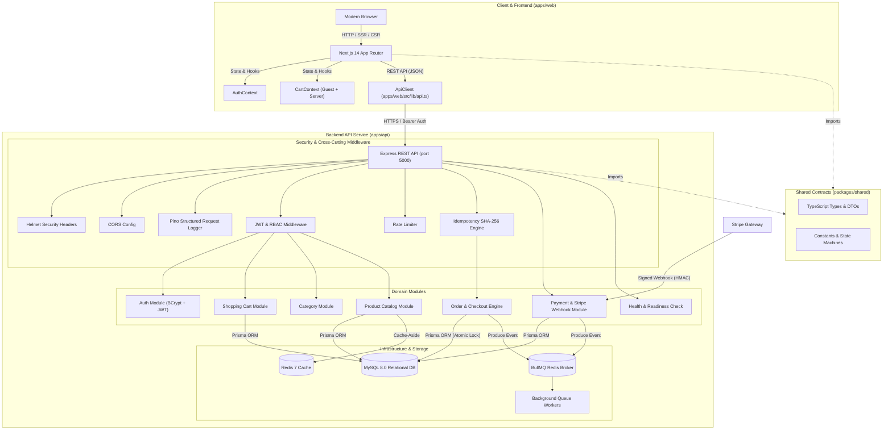

# 🏛️ OrderFlow System Architecture

OrderFlow is an enterprise-grade modular monolith e-commerce platform with a decoupled Next.js storefront and Express REST API service.

---

## 1. High-Level Monorepo Architecture



---

## 2. Monorepo Organization

| Workspace / Directory | Type | Description |
| :--- | :---: | :--- |
| `apps/web/` | Application | Next.js 14 storefront with App Router, server/client components, responsive styling |
| `apps/api/` | Application | Express REST API with Prisma ORM, BullMQ workers, OpenAPI docs, and full test suites |
| `packages/shared/` | Package | Shared TypeScript interfaces, DTOs, domain enums, and order state machine definitions |
| `infra/docker/` | Infrastructure | Multi-stage Dockerfiles (`Dockerfile.api`, `Dockerfile.web`) and `docker-compose.yml` |
| `infra/render/` | Infrastructure | Render blueprint (`render.yaml`) and process definitions (`Procfile`) |
| `docs/` | Documentation | Architecture diagrams, API usage guides, and deployment workflows |
| `.github/workflows/` | CI/CD | GitHub Actions pipelines for automated testing, linting, typechecking, and security audits |

---

## 3. Core Architectural Highlights

### 3.1 Concurrency Control & Atomic Stock Decrement
To prevent overselling under high concurrency, OrderFlow executes atomic conditional SQL updates directly within a database transaction:
```sql
UPDATE inventories 
SET availableStock = availableStock - ?, reservedStock = reservedStock + ? 
WHERE productId = ? AND availableStock >= ?;
```
If the affected rows are 0, the transaction aborts with a 409 Conflict, ensuring zero race conditions.

### 3.2 High-Assurance Idempotency Engine
To prevent double charging on checkout:
1. Every checkout request generates an `Idempotency-Key`.
2. The middleware computes a deterministic SHA-256 hash over the route, verb, and sorted JSON body.
3. If an identical request arrives while the first is in progress, the API immediately responds with `409 Conflict`.
4. Subsequent identical retries receive the cached outcome with an `Idempotent-Replay: true` header without re-executing logic.
5. If the same key is supplied with a modified payload, the API rejects it with `422 Unprocessable Entity`.
